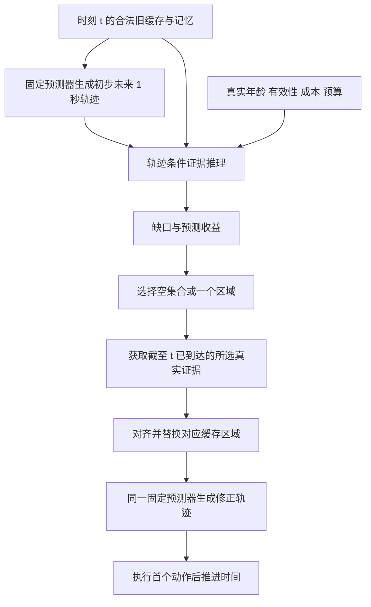

# FRESH-Drive：两阶段训练与动作预测器有效性验收方案

日期：2026-10-31（Asia/Shanghai）  
状态：研究与实施约定，尚无本文验收实验结果。

本文统一记录当前确定的模型主线、数据与因果协议、JEPA / Plan-R1 的借鉴边界，以及第一阶段动作预测器的有效性验收。后续搭建模型、训练、选模和进入第二阶段时，以本文的阶段边界和验收规则为依据；具体刷新评测沿用 [模型评估协议与实验矩阵](FRESH-Drive_模型评估协议与实验矩阵_2026-10-30.md)，实现级网络接口见 [因果 BEV 动作预测与区域刷新模型架构](FRESH-Drive_因果BEV动作预测与区域刷新模型架构_2026-10-31.md)。

**当前选择：先建立并验证适配现有 BEV 数据的动作预测器，再冻结该预测器，学习真实视觉更新的收益与预算约束刷新策略。** 第一阶段不以提出新规划架构为目标，第二阶段的贡献必须由真实更新带来的决策改善证明。

## 1. 已确定的设计与尚待验证的扩展

| 项目 | 当前约定 |
| --- | --- |
| 训练输入 | 相机融合后的 BEV 特征，不直接以 JPG 作为动作模型输入 |
| 动作输出 | 自车连续局部运动增量 `[dx, dy, dyaw]`，通过 SE(2) 合成轨迹 |
| 数据窗口 | 10 Hz，锚点前 2 秒、锚点、锚点后 1 秒，共 31 个时刻 |
| 主评测协议 | 在锚点生成完整未来 1 秒轨迹，解码期间不读取真实未来 BEV |
| 第一阶段 | 预训练 BEV 编码器基础上，训练轻量空间/时序编码和动作解码模块 |
| 第二阶段 | 固定第一阶段模型，训练证据推理、更新收益与预算选择模块 |
| 事件名称 | 不作为提示词、动作条件或策略输入；用于筛选、采样与分组评价 |
| 历史专家轨迹 | 不作为策略输入 |
| 未来专家运动 | 作为动作监督与离线评价；teacher forcing 仅允许训练时使用此前动作标签 |
| 刷新单位 | 第一版使用 BEV 空间区域；不能直接解释为某一路相机 |
| 世界模型 | 可选的动作条件潜在动力学扩展，先验证一步预测，不作为首轮验收前提 |
| 思维链 | 优先研究可监督、实际参与选择的结构化证据推理，暂不要求生成自然语言 |
| 闭环与强化学习 | 后续独立阶段；离线事件窗口和特征替换不等于闭环驾驶 |

第一阶段合格与第二阶段值得开展，是两个不同结论。一个强预测器可能已经对旧观测足够鲁棒，使当前任务几乎没有刷新空间；这不意味着预测器弱。

## 2. 数据、动作与评价目标

### 2.1 时间窗口

```python
FRAME_INTERVAL_US = 100_000
history_features = 20
future_action = 10
window_samples = 31
```

| 时间槽 | 时刻 | 用途 |
| --- | --- | --- |
| `0..19` | `t-2.0..t-0.1` | 历史视觉与缓存初始化 |
| `20` | `t` | 当前因果可用、可获取的新观测 |
| `21..30` | `t+0.1..t+1.0` | 专家监督、世界预测目标，以及时间推进后的日志回放观测 |

10 Hz 是目标采样频率，不保证每路相机每格都存在独立新图像。需要保存实际采集时间、来源帧 ID、重复与缺失状态，不能把规则查询时间当作真实观测时间。

共享 BEV 文件保存特征、有效区域与参考坐标，事件文件引用这些特征并保存监督。无需为了加入动作头或刷新模块，把同一特征复制进每个事件文件。

### 2.2 动作监督

第 `i` 个动作描述 `t+iΔt → t+(i+1)Δt` 的运动，`Δt=0.1 s`。监督来自记录自车位姿，是专家行为代理，并非原始转向、油门或制动命令。

若记录的未来累计位姿在锚点坐标系中为 `(p_i, ψ_i)`，起点为 `(p_0, ψ_0)=(0,0)`，则：

\[
\Delta p_i=R(-\psi_{i-1})(p_i-p_{i-1}),\qquad
\Delta\psi_i=\operatorname{wrap}(\psi_i-\psi_{i-1}).
\]

直接对锚点坐标中的 `x/y` 做差，不等于前一帧局部坐标中的位移。动作反积分必须能重建原始 `future_trajectory`。

局部动作监督要求相邻两端位姿有效。累计轨迹评价使用连续有效前缀；一旦中间动作无效，不能继续把其后的积分结果作为有效预测。完整 `FDE@1s` 仅使用具有完整 1 秒有效监督的样本，其他长度单独报告。

### 2.3 指标

主指标为 `ADE@1s`、`FDE@1s`，同时报告 `L2@0.1/0.3/0.5/1.0s`、周期航向误差和误差 P90/P95。ADE/FDE 直接对齐原始累计专家轨迹，避免预测与错误转换标签采用同一错误而互相抵消。

额外按事件、速度、转向、视觉年龄和缺帧条件分组，报告支持量与事件宏平均。速度、加速度、jerk 仅作补充诊断，需固定差分和滤波方法，不能把位置噪声放大后的数值直接解释为驾驶舒适性。

专家轨迹不是所有合法驾驶方案的唯一真值。较低 ADE 说明记录行为拟合更好，不能单独证明更安全或更符合所有路线意图。

## 3. 先建立预测器，还是复用他人预测器

“建立预测器”不意味着所有模块都从零训练。当前优先采用预训练 BEV 编码器，训练适配当前缓存的轻量动作模型，可借鉴已有网络结构。

| 维度 | 建立适配现有 BEV 的动作预测器 | 直接复用已有完整预测器 |
| --- | --- | --- |
| 接口 | 时间、坐标、动作与缺失处理可统一控制 | 需要匹配编码器、特征语义、路线和状态输入 |
| 训练成本 | 需要监督训练与独立验证 | 接口兼容时较低，迁移复杂时未必节省 |
| 决策能力 | 受数据规模和训练质量限制 | 成熟权重可能更强，但跨数据集后必须重测 |
| 刷新实验 | 易控制历史状态、缓存与信息访问边界 | 要排查模型内部记忆和其他新视觉通路 |
| 主要研究风险 | 特定弱预测器上获益，无法说明通用性 | 适配失败或额外输入掩盖视觉刷新作用 |
| 后续用途 | 第一版机制验证的固定基础 | 外部模型验证，增强方法通用性证据 |

相同 BEV 张量形状不代表表示兼容。不同编码器、BEV 范围、参考系和训练任务产生的 latent 不能直接互换。Plan-R1 的结构化 agent/map 输入也不能直接接收现有 BEV。

本地已有的 LAW / CoIRL-AD、AutoVLA、DriveWorld-VLA 资料可作为结构和对照参考，但尚未确认某个公开规划权重能够直接读取当前缓存。这些发布状态来自历史资料，不代表最新在线核验或已完成权重运行。

## 4. 与 Plan-R1、JEPA 和 V-JEPA 2-AC 的关系

### 4.1 Plan-R1 的两阶段

本地 Plan-R1 的 `pred` 使用参与者运动 token、地图和路线，监督学习所有参与者的下一运动 token，包括自车。`plan` 将预训练权重复制给另一份规划网络，冻结原预测分支；其他参与者由预测分支推演，自车由规划分支生成，再通过奖励和 KL 正则训练规划网络。

FRESH-Drive 可以借鉴“先获得基本预测能力，再优化特定目标”，但冻结对象和第二阶段训练目标不同：我们不默认再训练一份完整自车策略，而是固定预测器，学习真实观测更新的价值。

### 4.2 V-JEPA 2-AC 的已核对内容

依据本地 [V-JEPA 2 论文](../../2506.09985v1.pdf) 第 3.1、3.2 节和图 6：

- 视觉表示预训练后，冻结视觉编码器，训练新的动作条件预测器。
- 输入视觉表示、动作与机器人状态，输出下一时刻视觉潜在表示。
- 动作由相邻记录机器人状态之差构造，不使用任务类别、成功标记或奖励元数据作为该阶段条件。
- 损失包含下一状态表示的 teacher-forcing L1 损失和两步 rollout L1 损失。
- 规划通过世界模型评估候选动作与目标表示的距离，再执行首个动作并重新观测。

| 模块 | 学习的问题 | 对应训练对象 |
| --- | --- | --- |
| 动作预测器 | 当前信息下应该输出什么运动？ | BEV 时序表示到动作的映射 |
| 动作条件世界模型 | 给定动作后，状态如何演化？ | 状态与动作到后继 latent 的映射 |
| 刷新模块 | 获取哪些真实观测可改善当前预测？ | 动作条件证据推理与价值估计 |

“JEPA 先训练编码器再训练隐空间，我们先训练预测器再训练隐空间”只能作粗略类比。实际训练的是处理潜在表示的网络参数；隐空间不是独立的优化对象。JEPA 预训练也不只是单独训练一个编码器。

第二阶段冻结参数，不代表隐藏状态固定不变。不同输入和观测更新仍会改变模型隐状态；冻结仅意味着不更新其权重。刷新 token 或 evidence token 可以有自己的可训练参数，但不能仅靠任意修改 latent 来绕过真实证据获取。

## 5. 第一阶段：训练一个可冻结的视觉动作预测器

### 5.1 模型输入输出

```text
BEV 空间特征 + 有效区域 + 时间与年龄
                   ↓
       空间编码与因果时序记忆
                   ↓
          自回归动作解码器
                   ↓
       未来 10 个 [dx,dy,dyaw]
                   ↓
         SE(2) 累计未来轨迹
```

BEV 空间 token 应保留到能够进行区域读取与替换的接口，避免过早池化后无法研究空间更新。第一版可使用轻量注意力和 GRU，不要求模型规模本身成为贡献。

真实导航或自车状态若加入，需单独声明其可用时间，并让比较方法使用一致条件。事件名称不能替代导航指令。没有路线时，路线歧义引起的错误不能全部归为优化失败。

### 5.2 主训练协议

在锚点 `t` 使用历史与截至 `t` 的合法输入，自回归输出完整未来 1 秒动作。第 `i` 步可依赖此前预测动作与内部状态，不得依赖真实 `t+0.1` 及之后的 BEV。

训练时可以使用前一步专家动作进行 teacher forcing；当前动作标签不能进入当前输出的计算路径。正式验证、测试与第二阶段查询统一使用模型自己的动作前缀。teacher-forcing 指标只能作为训练诊断，不能代替推理质量。

动作损失起点：

\[
L_{action}=L_{SmoothL1}(\hat{\Delta p},\Delta p^*)
+\lambda_\psi L_{SmoothL1}(\operatorname{wrap}(\hat{\Delta\psi}-\Delta\psi^*),0)
+\lambda_\tau L_{trajectory}.
\]

轨迹损失可按验证结果决定是否加入。损失尺度、有效 mask 和选模指标必须固定，不能仅以训练总 loss 降低判断预测器已经合格。

### 5.3 陈旧与缺失模式

训练与验证需覆盖计划用于第二阶段的输入模式，包括真实年龄 `0/100/200/400/800/1000 ms`、全局陈旧、混合区域年龄、缺帧及重复帧。年龄范围是实验设置，最终需按真实时间戳和数据支持情况核实。

旧 BEV 通过当前已知定位对齐；越界区域标记无效，不凭未来参与者真值补偿动态目标。历史记忆也必须由同一合法观测序列建立，不能先看新特征再只把表面 token 换旧。

所有第二阶段策略共享同一个通过验收的 checkpoint，不能为不同刷新策略各换一个更强的预测器，也不能故意降低其鲁棒性制造收益。

## 6. 第一阶段有效性：先区分三个结论

| 结论 | 含义 | 对后续工作的作用 |
| --- | --- | --- |
| A：预测合格 | 独立数据上具备可接受的自回归运动预测能力 | 可以作为固定决策基础 |
| B：视觉有效且输入适配 | 正确视觉有贡献，能够处理计划内的陈旧与缺失 | 可以用于真实视觉更新研究 |
| C：存在更新空间 | 固定预测器后，真实区域更新有可测、可重复的收益 | 值得训练第二阶段选择器 |

**排除已知失败现象不等于逻辑上证明模型正确。验收需要正向效果、可接受误差和足够精确的统计区间。** A、B 通过后可冻结预测器；C 也通过，才正式进入刷新策略学习。

一个预测器可能 A、B 合格而 C 不成立，例如当前任务太简单或旧视觉已经充分；此时不能反推预测器太弱。

### 6.1 失败条件一：实现或标签不正确

检验：

1. 推理设为 `eval`，关闭 teacher forcing，改变全部未来 BEV、未来专家动作及事件元数据；锚点整条轨迹应在数值容差内保持不变。
2. 刷新前改变尚未获取的当前区域特征，初步轨迹、gap 和 utility 不应改变。
3. 用真实局部动作重建累计位姿，检查转弯、航向跨 ±π、缺失监督与有效前缀。
4. mask 为假的像素、动作和时间步不参与对应损失，指标不因填充值变化而改变。
5. 检查真实帧来源、时间单位、坐标轴、参考位姿和实际图像时间，不把重复帧算作新信息。

通过标准：计算路径与目标定义一致，重建误差处于预先声明的数值容差。任何一项失败，都先修实现，不对模型强弱作结论。

### 6.2 失败条件二：优化没有成功

先用少量高质量、无明显条件歧义的样本作容量和优化诊断。训练误差应显著降低；同时检查梯度、冻结范围、动作尺度、有效样本量和学习率。

| 现象 | 优先检查的原因 |
| --- | --- |
| 训练与验证误差都很高 | 实现、优化、表示、容量或输入信息不足 |
| 训练很好、验证明显较差 | 过拟合、划分、数据规模或分布变化 |
| teacher forcing 好、自回归差 | 训练推理不一致与误差累积 |
| 长时间平台且误差仍高 | 不等于已训练好，需要基线和误差分析 |

小样本拟合成功只是链路检查，不代表泛化。存在噪声、路线多解或不可观测因素时，也不要求训练误差严格归零。

### 6.3 失败条件三：没有足够的独立预测能力

至少设置以下对照：

| 对照 | 用途 | 信息条件 |
| --- | --- | --- |
| 常速度外推 | 检查短期惯性是否已能解决任务 | 只用因果可用速度等状态 |
| 常转率、常速度外推 | 检查转弯运动学基线 | 明确速度与角速度来源 |
| 仅自车状态学习模型 | 检查视觉之外的运动先验 | 不使用专家未来或事件标签 |
| 简单视觉模型 | 检查复杂结构是否必要 | 同 BEV、同时间窗、同额外条件 |
| 候选动作预测器 | 第一阶段目标模型 | 固定接口与评价目标 |

若主策略为 BEV-only，状态基线可以使用已知里程计作独立诊断，但需明确其额外信息，不能称为完全相同输入。严格的视觉增益消融应让视觉版和非视觉版共享相同非视觉条件。

通过标准：总体与关键事件组的绝对误差、尾部误差达到预定要求；在预先定义的视觉交互场景，相比合理基线具有实际意义的改善。不能用大量静止、直行样本掩盖制动和转向失败。

如果 1 秒任务已被惯性基线近乎解决，缺少胜出空间不一定说明模型弱。先判断样本是否覆盖视觉驱动的决策变化，不能强行改坏预测器或临时挑选有利测试样本。

### 6.4 失败条件四：只记住了训练录制

正式泛化验证需按原始 driving log 隔离训练、验证和测试；同一 log 的 DB 分片不能跨集合。先建立 DB 到原始 log 的映射，再检查共享源图像与重叠窗口。

这是一项正式验收协议要求，不表示当前缓存划分已修改。若继续使用事件随机划分，其结果只能作为开发诊断，不能当作独立录制泛化证据。

报告每个事件组、速度组、转向组的样本数与独立 log 数，处理同一锚点的多事件标签重复计数。Mini 用于开发；只有 train/val 时不能反复看验证结果后再称其为独立测试成绩。

### 6.5 失败条件五：视觉没有提供有效信息

需要组合证据，而非只做一次全零遮挡：

1. 在相同非视觉条件下，视觉模型相比非视觉模型改善预先定义的交互场景预测。
2. 使用合法旧特征替换规划相关区域，并配同面积、相近有效率的非相关区域或随机区域对照。
3. 比较预测质量而非仅比较输出变化；恢复真实新证据后，应在相关场景恢复或改善质量。
4. 相关区域定义使用独立标注或可复核关联，仅供诊断，不能用模型自己的热图同时定义和验证。

跨样本打乱 BEV 或全零遮挡可能产生分布外输入。性能下降只能说明敏感，不能单独证明理解视觉。融合 BEV token 存在大感受野和跨区域信息，区域替换支持表示层结论，不自动证明某个物体的物理因果作用。

通过标准：视觉在正确配对的场景中有可重复的性能贡献，影响具有相关性，真实证据恢复能够带来改善。注意力可视化与解释文本不构成替代证据。

### 6.6 失败条件六：不适应刷新阶段的陈旧输入

固定年龄与缺失设置，分别报告误差、异常轨迹率、尾部性能和恢复新观测后的结果。陈旧分支和新鲜分支使用共同目标时间、相同状态和相同自车运动对齐。

通过标准：计划内输入扰动下仍满足预设容忍范围，恢复真实观测后具有可用的恢复表现。每个样本的误差不必随年龄单调变化，所有新区域一起更新也不必逐样本最好。

若训练年龄模式与第二阶段差异很大，应先适配并重新验收，再统一冻结新 checkpoint。不能在正式比较中只为完整方法提供额外适配。

### 6.7 失败条件七：冻结后不存在有意义的更新空间

冻结并设为 `eval`，克隆同一缓存、记忆、初步规划和自车状态。第一版把 BEV 分为 `3×3` 宏区域，每次最多更新一个区域，测量九个单区域替换与不更新结果。

\[
U_r=D(\tau^0,\tau^*)-D(\tau^r,\tau^*).
\]

`D` 首版固定为共同有效时刻的轨迹 ADE。`τ⁰` 是用旧视觉重新计算的轨迹，`τʳ` 仅多使用区域 `r` 的真实新证据。标签保留正、零、负收益。

定义包含空选择的同预算离线参考：

\[
U^*=\max(0,\max_{r:c_r\le B}U_r).
\]

检查有意义收益场景的比例、独立 log 数、收益幅度与区间，并比较这个离线参考、不更新和等成本随机更新。区域收益差异可判断空间选择是否存在研究空间；若所有区域收益相近，可能只有刷新时机值得研究。

`U*` 使用真实专家目标事后挑选，不能用于部署。它存在只说明当前候选集合中有选择空间，不保证旧信息足以预测哪个区域最好；后者仍需第二阶段在独立数据上验证。

通过标准：有足够独立支持的真实更新收益，幅度超过预定实际意义阈值，且不是数值噪声、分布外破坏或少数偶然样本。无收益时分别检查表征、视觉依赖、缓存新鲜度、任务饱和和预测器能力，不能一律归因为预测器太弱。

### 6.8 失败条件八：统计不稳定或选模偏置

- 验证集用于选模与阈值校准；正式独立测试前锁定规则。
- 建议至少三个训练种子，例如 `42/43/44`，报告单独结果和汇总，不能只挑最好一次。
- 同一场景各方法共享随机干预与状态，使用配对比较。
- 以原始 log 为簇估计区间，例如配对 bootstrap 2,000 次并报告 95% CI；训练种子波动另外报告。
- 密集窗口和时间步不能被当作独立样本，不能用帧数放大显著性。
- 独立 log 或关键事件支持不足时，结论为“证据不足”，不是通过。

“未发现显著变差”不是等效证明；“p 值显著”也不代表实际改善足够。应检查区间是否满足预定误差、改善或非劣界限。

## 7. 可执行的验收表与冻结条件

目前没有实验结果，不预设一个未经依据的 `ADE<0.1 m` 或统一提升百分比。先在开发集结合标注质量、基线和研究需求确定容忍值，再锁定协议测试。未填写阈值的项目不能按“默认通过”处理。

| 项目 | 测量方式 | 测试前锁定的规则 |
| --- | --- | --- |
| 因果性 | 改变不可见信息后的最大输出差 | 不超过确定性计算的数值容差 `ε_causal` |
| 动作正确性 | SE(2) 重建原始轨迹误差 | 不超过坐标与精度允许的容差 `ε_pose` |
| 总体质量 A | 自回归 ADE/FDE 及其区间 | 误差上界低于各自容忍值 `ε_ADE/ε_FDE` |
| 长尾质量 A | P95 与关键事件组指标 | 每组满足预定上限，并报告不足支持组 |
| 相对能力 A | 配对基线误差减去模型误差 | 预设视觉交互组的改善区间下界超过 `δ_pred` |
| 视觉价值 B | 匹配消融和证据恢复的配对结果 | 超过 `δ_visual`，排除仅分布外敏感解释 |
| 输入适配 B | 各年龄和缺失模式下误差与恢复 | 满足模式相关容忍值，不设逐样本单调要求 |
| 更新空间 C | `U*`、有意义阳性率与区域差异 | 收益、场景支持量及区间满足预定要求 |
| 稳定性 | 种子与独立 log 区间 | 不依赖单个种子或少数 log 的偶然改善 |
| 运行成本 | batch=1 实际延迟与显存 | 满足声明的原型预算；不能只报单个 kernel |

`δ_pred`、`δ_visual` 和刷新收益阈值是实际意义下限，应以米等明确单位记录。基线接近标注误差或任务下限时，要重新判断任务的检验能力，而非为了通过验收降低阈值。

冻结决策：

```text
实现与数据正确？
    否 → 修复，不解释训练成绩
    是
    ↓
A：独立预测合格，B：视觉有效且陈旧适配？
    否 → 继续第一阶段诊断与训练
    是 → 保存并冻结验收 checkpoint
    ↓
C：同状态真实更新存在有意义收益？
    否 → 检查任务、数据与表征；不强行训练复杂刷新器
    是 → 生成训练收益标签，进入第二阶段
```

冻结时保存权重来源/hash、数据清单与划分版本、输入条件、训练种子、损失与选模规则、验收结果。进入第二阶段后保持基础权重不变，但隐状态仍随合法输入变化。冻结模块保持 `eval`，检查参数梯度和权重一致性。

## 8. 第二阶段：学习真实视觉更新价值

### 8.1 因果顺序

第一版采用同一时刻的初步规划与修正规划：



旧状态不能提前含有待获取的新观测。若已经使用完整锚点 BEV 建立隐藏状态，就不能通过仅替换表面 token 声称模拟“尚未获取锚点新视觉”。缓存初始化的观测与计算成本需要记录。

初步与修正轨迹必须覆盖相同绝对目标时间。跨时刻修正只比较共同剩余时域，不能用缩短预测长度制造误差改善。

### 8.2 固定什么，训练什么

| 部分 | 第二阶段处理 |
| --- | --- |
| BEV 特征编码与动作模型输入编码 | 固定 |
| 时序骨干与动作解码器 | 固定，并保持 `eval` |
| 同状态评价用的轨迹更新器，如单独建立 | 提前训练完成并固定，所有方法一致 |
| 轨迹 query、证据推理与收益预测 | 可训练 |
| 预算约束选择 | 按预测收益与真实可用性执行，允许空集合 |
| 可选世界模型 | 先独立验证；比较刷新策略时固定，避免收益来源混淆 |

新证据通过受控替换进入基础模型。第一版不允许刷新器自由生成动作隐向量，仅用动作 loss 将其训练成另一个规划器；否则无法归因于真实观测获取。

### 8.3 收益监督与优化

用冻结模型构造 `U_r` 标签后训练收益头：

\[
L_{refresh}=\sum_{r\in\mathcal A}\operatorname{Huber}(\hat U_r,U_r).
\]

硬阈值或 `top-k` 通常无法直接把动作损失反传给选择器。第一版用明确的收益回归训练，不假定不可导选择会自动学会。动作误差继续用于评估。

选择规则为：

\[
\hat S=\arg\max_{S\in\{\varnothing,\{1\},\ldots,\{9\}\},\ c(S)\le B}
\left[\hat U(S)-\lambda_c c(S)\right].
\]

多区域更新存在互补或冲突，不能直接把单区域收益相加宣称最优。后续扩展需测量成组或条件边际收益。

分别保留“原规划不变”“旧视觉重规划”“新视觉后重规划”三个分支。`U` 衡量新证据相对旧视觉重规划的额外收益；若要声称改善原规划，还需评价：

\[
W=D(\kappa,\tau^*)-D(\tau^{refresh},\tau^*).
\]

`U>0` 不保证 `W>0`。获取前选择 E1，与读取新证据后决定是否重规划/采用的 E2，应分别报告。

## 9. 结构化证据推理与“思维链”的验证

最小研究链条为：

```text
初步轨迹 → 相关证据与缺口 → 预期更新收益 → 预算选择
```

第一版不要求语言模型或人工生成完整驾驶解释。可学习的 evidence token 必须进入实际收益计算路径，不能作为旁路输出后就声称顺序推理成立。

缺口可以先操作性定义为“更新该区域能带来超过阈值改善的概率”。没有语义监督时，不能把隐 token 自动命名为“缺少行人证据”或声称其理解了行人意图。

需要三组验证：

1. 同预算比较直接收益头、同参数量模型、普通辅助头和缺口瓶颈模型，计入推理开销。
2. 匹配相关/非相关区域证据干预，检查缺口、选择和最终收益是否一致变化。
3. 替换或打乱中间缺口，验证实际路径，同时检验语义/操作定义与最终收益；输出受影响只是必要条件。

若直接收益预测同样有效，保留简洁模型，不能把没有独立增益的“思维链”强行列为主要贡献。

## 10. 世界模型扩展：辅助预测，不替代真实证据

可选世界模型学习：

\[
\hat z_{k+1}=F_\phi(h_k,a_k,\Delta t),\qquad
z^*_{k+1}=\operatorname{stopgrad}(E(BEV_{k+1})).
\]

先训练一步特征预测，可靠后再借鉴 V-JEPA 2-AC 增加两步 rollout。目标表示需来自固定编码器或明确设计的稳定目标网络，不能让预测与目标任意共适应形成无信息表示。

记录动作可在独立世界模型监督分支作为转移条件，不进入当前策略或刷新查询。以预测动作推演时，记录后继状态不一定是该动作的正确反事实目标，不能无条件强配对。

真实未来位姿可以用于构造监督目标；在线推演只能使用当前已知状态与预测运动。真实下一帧在当前步只作为监督，时间推进后才可作为新观测。

| 主锚点协议 | 补充逐帧日志回放 |
| --- | --- |
| 在 `t` 生成全部 10 步动作 | 到 `t+iΔt` 后重新作当前决策 |
| 真实观测最多到 `t` | 动作 `i` 的观测最多到槽 `20+i` |
| 可使用模型生成的动作和预测 latent | 可按选择获取已到达真实观测 |
| 衡量锚点 1 秒规划 | 衡量连续因果日志预测，不能混作同一成绩 |

此前世界模型文档中“第 i 步可访问至槽 20+i”的规则仅用于右侧回放协议，不适用于左侧锚点整段规划。最后一帧 `slot=30` 可作终止状态和世界预测目标，不能提前参与前 10 个动作。

预测 BEV 不等于真实新证据，不能重置观测年龄。预测不确定性需校准，不能仅凭一个确定性头或特征误差宣称风险估计有效。nuPlan 日志对未执行动作的环境反应覆盖有限，不足以自动建立可靠强化学习仿真器。

## 11. 当前实现差距与实施顺序

以下为本次阅读发现的待处理项，不是已完成修复或已通过验收的声明：

| 待处理内容 | 当前问题或核对要求 |
| --- | --- |
| 模型动作时序 | 当前 `forward` 在动作输出前读取 `H+1+i` 的真实 BEV；主锚点协议需隔离全部未来 BEV |
| 数据因果 mask | 当前 offset 与阈值混用了槽索引，H=20/F=10 时会放行全部窗口 |
| 局部动作转换 | 当前累计 xy 直接差分，需按前一姿态旋转并验证积分重建 |
| 划分 | 当前按事件类型随机划分，正式验收需独立 log 协议；不能悄悄把现有成绩称为已满足 |
| 视觉有效性与时间 | 模型需真实使用 valid、时间和年龄，并核对 BEV 对齐与来源时间 |
| 刷新模块 | 当前实现不能替代本文的选择前隔离、动作条件收益和预算约束验证 |
| 收益 loss | 当前 utility 的零值平方目标不是真实刷新收益监督 |
| 缓存与数据版本 | 修改采样/格式后，需明确旧清单兼容性，避免直接跳过新预处理 |
| checkpoint | 同阶段恢复与阶段一到阶段二初始化需区分，不能冻结随机初始化预测器 |
| 说明文件 | 旧说明可能仍描述逐相机或回放接口，实施时按本文与正式评测协议同步 |

建议执行顺序：

1. 修正数据、因果、坐标和独立评价条件，建立最小正确性检查。
2. 跑运动学/状态/简单视觉基线，完成少量样本优化诊断。
3. 训练主动作预测器，验证自回归、视觉依赖与陈旧适配，完成 A、B 验收。
4. 固定 checkpoint，测逐区域真实替换收益，完成 C 验收。
5. 在训练集生成收益标签，训练直接收益头，建立第二阶段基线。
6. 有证据再加入缺口瓶颈和世界预测，逐项同预算消融。
7. 后续使用外部预测器、更多数据与 CARLA 检查通用性及闭环表现。

预处理、测试、实验与训练统一使用 `FRESH-Drive` Conda 环境。调试、统计与验收工具放在 `tools/`；必要实验实现与最小复现信息不能依赖未公开的调试日志。涉及 Dataset 实现修改时，继续遵守双文件同步维护约定。

## 12. 论文结论与适用范围

通过 A、B，可以表述为：**在规定的独立数据、1 秒预测时域、合法输入和陈旧设置下，动作预测器具有足够预测能力并有效利用视觉，适合作为固定评价基础。**

通过 C，可以增加：**在这一固定预测器上，真实视觉区域更新存在可测、可重复的规划收益，支持研究刷新策略。**

第二阶段仍需证明选择器能够在获取前预测收益，并在相同预算下优于简单策略。不能由第一阶段合格直接推出刷新模块有效。

融合 BEV 局部替换验证的是表示更新价值。若完整 BEV 已经编码，不能把区域更新比例当作上游相机或 BEV 编码的计算节省。必须计入初步规划、选择、编码/读入、对齐与最终规划的实际开销。

以上结论不等于通用驾驶能力、任意动作的反事实可靠性或闭环安全保证。研究主张应围绕“刷新前的动作条件证据推理与视觉更新价值”，不以自建预测器、引入世界模型或产生解释文本本身作为创新结论。

## 13. 相关依据与后续记录

- [BEV 时序动作预测与证据刷新统一方案](FRESH-Drive_BEV时序动作预测与证据刷新统一方案_2026-10-29.md)：窗口与加载基础；回放规则需按本文区分主协议。
- [模型评估协议与实验矩阵](FRESH-Drive_模型评估协议与实验矩阵_2026-10-30.md)：同状态标签、E1/E2、主表与统计规则。
- [动作条件 BEV 世界模型与证据刷新方案](FRESH-Drive_动作条件BEV世界模型与证据刷新方案_2026-10-30.md)：世界预测扩展；不是第一阶段验收的必要前提。
- [动作条件证据推理与验证方案](FRESH-Drive_动作条件证据推理与验证方案_2026-10-23.md)：同预算、证据干预和中间变量验证。
- [Dataset 双文件同步维护约定](FRESH-Drive_数据集双文件同步维护约定_2026-10-28.md)。
- [本地 V-JEPA 2 原论文](../../2506.09985v1.pdf)：第 3.1、3.2 节与图 6。
- [本地 Plan-R1 训练逻辑](../plan_r1_user/model/PlanR1.py)：`pred` 监督训练、`plan` 权重复制/冻结与奖励优化。

后续填入实际阈值、数据清单、checkpoint 和结果时，应保留实验配置与失败分组。本文目前仅确定验收方法，不填写未测数值，不将设计目标写成已获得结果。
