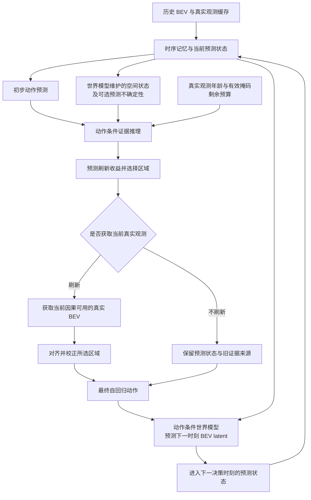

# FRESH-Drive：动作条件 BEV 世界模型与证据刷新方案

日期：2026-10-30（Asia/Shanghai）

后续约定见 [两阶段训练与动作预测器有效性验收方案](FRESH-Drive_两阶段训练与动作预测器有效性验收方案_2026-10-31.md)：世界模型属于可选扩展，不是第一阶段验收前提。本文第 4 节逐帧推进规则用于日志回放；锚点一次规划未来 1 秒时，不读取任何真实未来 BEV。

本文记录在 FRESH-Drive 中引入轻量世界模型的研究方案，作为 [BEV 时序动作预测与证据刷新统一方案](FRESH-Drive_BEV时序动作预测与证据刷新统一方案_2026-10-29.md) 的扩展。本文描述预期设计与验证方法，不表示相关模块已经实现或通过实验。

## 1. 引入目的与研究定位

世界模型学习“在当前环境状态下执行某个动作，下一时刻的环境表示如何变化”。第一版预测压缩后的 BEV 空间特征，不生成未来相机图像，也不要求先构建完整 OCC。

FRESH-Drive 的研究目标保持为：根据当前预测动作判断视觉证据是否仍然有效，在预算内决定何时刷新、刷新哪些 BEV 区域，并验证刷新对动作决策的价值。

世界模型为这一过程提供预测状态；经过校准的预测不确定性可以作为证据缺口的辅助信号。事件名称不作为文本提示词或模型输入，`event_type` 仅用于数据筛选、采样和分组评估。

需要区分三个概念：

| 概念 | 含义 | 在模型中的作用 |
| --- | --- | --- |
| 真实 BEV 观测 | 由当前可用传感器数据编码得到的特征 | 校正状态，补充真实视觉证据 |
| 世界模型预测 | 由旧观测、时序记忆和动作推演得到的潜在状态 | 在缺少新观测时维持状态估计 |
| 预测不确定性 | 经验证的预测可靠程度估计 | 辅助判断当前动作是否需要新证据 |

预测特征不能被记录为真实刷新，不能重置真实观测年龄，也不能单凭较低预测误差宣称驾驶风险较低。

## 2. 保持现有数据窗口

继续采用固定方案：

```python
FRAME_INTERVAL_US = 100_000   # 10 Hz
history_features = 20        # 锚点前 2 秒
future_action = 10           # 锚点后 1 秒
window_samples = 31         # 20 帧历史 + 锚点 + 10 帧未来
```

每个样本包括历史与锚点 BEV、未来 BEV 引用、未来专家运动、有效掩码、时间戳以及 BEV 参考坐标信息。未来动作是记录自车位姿构造的局部运动增量 `[dx, dy, dyaw]`，并非原始控制器输出。

加入世界模型本身不要求扩大窗口，也不要求把同一份 BEV 特征复制进事件文件。原则上可复用符合上述时间采样、坐标和因果约定的共享缓存；旧版本缓存需要先核对格式与采样配置。

| 时间槽 | 时刻 | 用途 |
| --- | --- | --- |
| `0..19` | `t-2.0..t-0.1` | 历史视觉上下文 |
| `20` | `t` | 锚点观测 |
| `21..30` | `t+0.1..t+1.0` | 世界模型监督目标，以及后续因果回放观测 |

历史专家轨迹不作为策略输入。用于 BEV 对齐的历史或当前自车位姿属于传感器状态，应与专家动作监督分开处理。

## 3. 模型结构

第一版世界模型可以用轻量 Transformer 或 GRU 实现，保留空间 token，避免将所有区域过早压缩为单个向量。

记 `h_k` 为时序记忆，`a_k` 为当前动作，`z_k` 为 BEV latent，时间步长为 `Δt=0.1 s`：

```text
预测下一状态：z_hat[k+1] = F(h[k], a[k], Δt)
真实观测编码：z_obs[k+1] = E(BEV[k+1])
观测校正：   h[k+1] = Update(h_prior[k+1], observed_regions)
```

动作条件作用于世界模型的状态转移，也作用于证据缺口和刷新收益估计。



这里“当前预测状态”来自此前的状态转移，不依赖尚未获取的当前真实 BEV。缓存需要区分真实观测和推演状态，并记录各区域最近一次真实观测时间。预测过程中观测年龄继续增长；只有获取真实观测后，相应区域的观测年龄才更新。

初始化可使用历史与锚点 BEV。若锚点 BEV 已作为初始化输入，则不能再把获取同一份锚点 BEV 计作额外刷新收益。

## 4. 因果训练与回放规则

第 `i` 个动作对应 `t+iΔt → t+(i+1)Δt`，只能访问时间槽 `0..20+i`。

```text
观察至 t
    ↓
预测动作 a[0]
    ↓
世界模型预测 t+0.1 的 BEV
    ↓
真实 t+0.1 BEV 仅用于这一转移的监督
    ↓
推进到 t+0.1，先决定是否获取新观测
    ↓
获取被选中的真实证据并校正状态
    ↓
预测动作 a[1]
```

具体约束：

1. `action[0]` 只能读取至锚点 `slot=20`，不能看到 `slot=21`。
2. `action[9]` 最多读取至 `slot=29`。`slot=30` 可监督最后一次状态转移，但不能参与这 10 个动作的预测。
3. 刷新选择必须在读取待获取的真实 BEV 之前完成；离线缓存中存在该文件，不代表调度器可以提前使用其内容。
4. 当前专家动作不能进入当前动作预测或刷新查询。世界模型训练可在独立的转移监督分支使用记录动作 `a*[k]`，学习对应的记录后继状态。
5. 验证与推理使用模型自己的动作。训练阶段若对前一步动作采用 teacher forcing，需要与使用预测动作的评估结果分开记录。

在专家动作条件下，一步训练对为 `(h[k], a*[k], z_obs[k+1])`。在模型预测动作条件下，记录的真实后继状态不一定是该动作的正确反事实结果，不能无条件将二者视为严格匹配的监督对。

### 坐标与时间约定

相邻 BEV 通常处于不同的自车参考系。需要明确统一参考坐标，或在状态转移中显式处理自车运动，避免将自车坐标变换误当作环境动态。

历史与当前已知位姿可以用于对齐；记录的未来位姿只能用于监督目标构造和评估，不能作为预测滚动过程的隐藏输入。模型推演时的参考系变换依赖预测动作；真实当前位姿到达后，才可用于观测校正。

保留实际图像采集时间与 BEV 查询时间的区别，不能用规则采样时间覆盖真实采集时间。损失只在有效观测与有效运动监督上计算，对齐后的无效或越界区域不参与特征误差。

## 5. 训练目标

### 5.1 动作预测

沿用未来专家运动监督：

```text
L_action = SmoothL1(predicted_xy, expert_xy)
         + yaw_weight × SmoothL1(wrapped_yaw_error, 0)
```

累计轨迹上的 ADE/FDE 单独评估，必要时再增加轨迹损失。

### 5.2 BEV 潜在状态预测

第一版使用固定的 BEV 目标编码器 `E`，预测下一时刻空间 token：

```text
z_target[k+1] = stop_gradient(E(BEV[k+1]))
L_world = masked_feature_loss(z_hat[k+1], z_target[k+1])
L_total = L_action + λ_world × L_world
```

可使用归一化特征的 SmoothL1 或余弦距离，保持目标表示稳定。缺失区域不得通过填零后直接当作真实监督。

先验证一步预测，再研究短距离多步推演。只有一步预测可靠后，才考虑加入少量预测头或小型集成估计不确定性，并验证不确定性与实际误差的关系。单个确定性预测头的输出不能自动解释为经过校准的不确定性。

### 5.3 刷新收益学习

世界模型的预测误差和不确定性是刷新判断的辅助信息，刷新收益的监督仍以动作决策为准：

```text
U(S) = D(action_from_unupdated_state, expert_action)
     - D(action_from_observation_corrected_state(S), expert_action)
```

其中 `S` 是刷新区域集合。两个分支使用同一个冻结动作预测器、同一份历史状态和同一决策时刻；差别仅为是否使用被选中的真实观测校正状态。

`U(S)` 可以为负，选择器允许不刷新。预算与刷新成本需要显式约束，不能将 BEV 预测误差直接等同于动作收益。

## 6. 分阶段实施

| 阶段 | 工作内容 | 验证目标 |
| --- | --- | --- |
| 0 | 修正时间槽、因果 mask、局部动作转换和坐标约定 | 确认基线没有未来信息泄漏 |
| 1 | 训练 BEV 动作基线，并加入轻量一步世界预测辅助任务 | 判断状态预测是否改善动作与陈旧观测下的表现 |
| 2 | 验证不确定性；冻结动作预测器和世界模型，训练证据推理与收益头 | 判断是否能提前估计真实观测的动作价值 |
| 3 | 在相同实际预算下比较刷新策略 | 验证动作收益及成本，而非仅展示预测可视化 |
| 4 | 机制成立后研究联合微调和 CARLA 闭环 | 检查误差累积、分布变化与闭环收益 |

当前代码接入前，需要检查 `model/fresh_drive.py` 中“预测动作前读取下一时刻 BEV”的顺序，以及 Dataset 中因果掩码的时间槽偏移。这些是实施前待修正项，本文不代表已完成修复。

## 7. 必要对照与评估

建议至少保留以下对照：

| 对照 | 用途 |
| --- | --- |
| BEV 动作预测基线 | 衡量加入世界预测的增益 |
| 持续沿用旧特征与自车运动对齐 | 判断世界模型是否超越简单状态保持 |
| 世界模型去掉动作条件 | 检验动作条件是否有实际价值 |
| 使用世界模型但固定频率刷新 | 区分状态预测与刷新调度的贡献 |
| 年龄或不确定性调度 | 判断动作条件收益估计是否优于简单规则 |
| 始终获取因果可用的新 BEV | 作为观测充分时的参考策略 |

指标包括有效区域 BEV 预测误差、动作误差、ADE/FDE、不同观测年龄下的性能、收益预测准确度，以及刷新次数、实际耗时和计算成本。如果使用不确定性，还需要报告误差校准结果。

特征预测与动作预测需分别报告。单凭较低的 BEV 特征误差、注意力图或合理的解释，不能证明刷新对驾驶决策有帮助。

## 8. 适用边界与贡献表述

nuPlan 提供记录专家行为及其后继环境，适合学习记录行为附近的短期潜在动力学。它无法充分覆盖任意动作引起的环境反应，因此不能直接证明反事实推演可靠，也不能自动作为强化学习仿真环境。后续闭环或强化学习仍需独立验证模型偏差与环境响应。

当前输入是融合 BEV。第一版可以研究区域状态更新与下游计算分配；如果先生成完整 BEV 再选择区域读取，不能将读取区域比例当作上游相机编码或 BEV 构建的节省比例。成本比较需要计入世界模型、调度器、真实观测获取和状态校正的开销。

研究贡献可以表述为：**利用动作条件的 BEV 状态预测和经过验证的不确定性，估计陈旧视觉证据对当前动作的有效性，并在预算约束下获取能够改善决策的真实观测。**

加入世界模型本身不是创新结论。需要通过动作条件消融、收益预测和同预算策略对照，证明该机制对 FRESH-Drive 的证据刷新问题有价值。

## 9. 相关文档

- [BEV 时序动作预测与证据刷新统一方案](FRESH-Drive_BEV时序动作预测与证据刷新统一方案_2026-10-29.md)
- [动作条件证据推理与验证方案](FRESH-Drive_动作条件证据推理与验证方案_2026-10-23.md)
- [nuPlan 预训练与 CARLA 闭环强化学习方案](FRESH-Drive_nuPlan预训练与CARLA闭环强化学习方案_2026-10-24.md)
