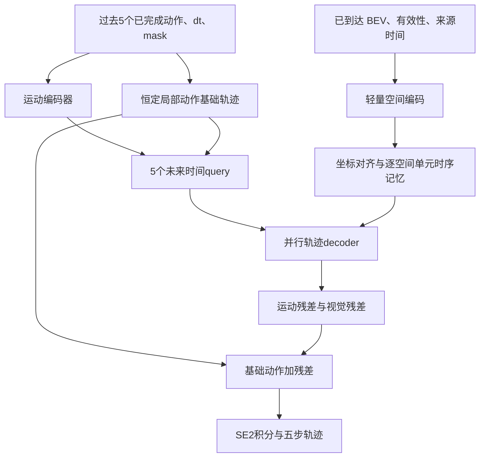

# FRESH-Drive 动作预测器重设计

日期：2026-11-04（北京时间）。状态：已按下述单步分工实现连续预测器 v2，见 [实现与运行说明](../../docs/action_predictor_v2.md)。尚未正式训练或验证真实预测质量。

2026-11-05 刷新目标更新：用户已明确采用 softmax 二分类学习“刷新并替换轨迹／继续旧轨迹”。后续刷新网络修改以[二分类门控实验设计与交接](FRESH-Drive_二分类刷新门控实验设计与模型改造交接_2026-11-05.md)为准；下文区域收益回归描述的是现有实现，不再作为新门控的完整目标。单步动作预测器的分工保持不变。

## 当前确定的方案（替代下方早期建议）

用户已确认：**保留单步动作预测器；五步滚动用于衡量刷新价值。先提高单步预测质量，同时验收五次递推的可靠性，不预先要求改成五步直接输出。**

### 模块职责

- 动作预测器：根据当前因果可用的视觉记忆和已约定的动作上下文，每次输出一个局部动作 `[dx, dy, dyaw]`。持续观察下的单步预测质量是当前优化重点。
- 滚动规划模块：连续调用同一个单步预测器五次，将动作通过 SE(2) 积分为五步候选轨迹；候选内部不读取真实未来 BEV、定位或专家动作。它组织递推，不新增独立五步动作输出头。
- 刷新模块：根据旧视觉状态、动作条件、证据年龄和预算预测区域更新价值，选择是否刷新及刷新位置。当前方案不让刷新模块成为另一个直接生成动作的预测器。

### 两阶段训练与监督

第一阶段先提高单步预测质量。动作预测器固定使用 L1，不再提供 MSE/SmoothL1 切换。当前四项系数为单步 XY 0.50、单步转角 0.10、累计位置坐标 L1 0.35、累计航向 0.05；角度误差按周期处理。累计监督作用于逐步读取已到达观察的十步因果回放，固定视觉五步仍仅用于验收。各系数是基于已有 CSV 诊断的初始实验值，不预设其最优，也不能由系数之和为 1 推断单步项在数值或梯度上主导；四项原始值和加权值分别记录，详见实现说明。

第一阶段验收同时包含：下一步动作误差与偏差、持续观察下的递推表现，以及固定合法视觉记忆下连续五次调用的 ADE/FDE。单步合格不能代替五次递推验收；后者用于检查刷新收益测量是否可靠，不要求预测器必须直接输出五步。专家动作前缀只作诊断，不能作为正式推理结果。

第二阶段冻结并 eval 同一个预测器。对同一旧状态逐区域独立更新，连续调用五次，计算：

```text
U[r] = ADE(旧视觉五步重规划, 专家轨迹)
     - ADE(刷新区域 r 后五步重规划, 专家轨迹)
```

保留正、零和负收益，用收益回归监督刷新模块。当前硬区域选择不可直接通过五步轨迹损失反传训练选择器；不能只增加轨迹 loss 就声称刷新策略能够获得梯度。

所有分支共享当前时刻、动作起始条件、隐藏状态初始化规则、坐标、目标时间和有效掩码；候选状态独立复制。回放与候选初始化差异、前缀敏感性和误差累积继续隔离验证。

### 贡献归属与后续顺序

先证明单步预测器可用、五次递推可靠，再训练刷新模块。所有刷新策略使用相同的冻结预测器，比较无刷新、随机、定频、年龄优先和学习策略的同预算结果。保留原规划、旧视觉重规划、新视觉重规划三个分支，分别评价视觉额外收益 U 与相对原规划总改善 W。

基础动作能力归于动作预测器；相同预测器下因证据选择产生的额外改善，才归于刷新策略。不通过故意限制预测器能力来制造刷新收益。

下方五步并行输出、运动学残差和默认新增历史运动输入的方案撤回为当前推荐，仅保留为历史讨论。不得据此修改当前模型或将其当作用户已确认的实现要求。

---

## 历史讨论：此前的五步并行输出提案（已撤回为当前推荐）

## 1. 结论与依据

推荐以**当前运动状态条件下、固定视觉记忆的五步并行残差预测器**替代当前动作自回归 decoder。先对齐 refresh 的候选规划任务，再考虑提高空间/时序网络容量。

依据为 `evaluation/action_diagnostics/README.md` 和当前代码：

- 完整验证中，1147 个唯一锚点的模型 ADE 为 0.1701 m，恒定动作基线为 0.0973 m。运动学基线有准确历史运动输入，当前模型没有相同的显式输入，不能把差距全部解释成网络容量不足。
- 25 个锚点诊断中，正常自回归 ADE 为 0.2057 m，专家前缀分支为 0.0768 m。支持优先处理前缀失配，但不证明某种修复已经有效。
- 同批样本固定视觉五步 ADE 为 0.1273 m，恒定动作基线为 0.0519 m。现有 action 训练目标与 refresh 候选任务不一致。
- 当前 `ActionDecoder` 从零 previous 起步，训练使用专家前一步动作；回放携带 decoder hidden，`RollingPlanner.decode()` 每个候选重新初始化 hidden、step。直接更换 previous 约定已在诊断中恶化，不应修改旧权重的推理输入来充当修复。
- 延迟分支退化明显，但年龄编码、输入分布、对齐和历史支持量存在混杂。原因仍待隔离，不能写为“已证实是 GRU 或年龄编码造成”。

## 2. 统一预测任务

定义一个共享接口：

```text
plan(visual_state_at_t, causal_ego_motion_at_t, horizon=5, dt=0.1)
    -> local_actions [B,5,3]
    -> trajectory    [B,5,3]
    -> plan_queries  [B,5,D]
```

一次调用只读取截至 t 已到达的视觉与运动信息。预测五步期间视觉状态固定，未来 BEV、未来定位和未来动作均不进入网络。输出轨迹在 t 的自车坐标系下，局部动作通过 SE(2) 积分得到该轨迹。

训练、action 验证、refresh 的旧视觉候选与逐区域新视觉候选，都调用同一接口。每个候选无跨调用 decoder hidden，无全局窗口 step 编号，使用相对未来时间 0.1～0.5 s。

持续回放时每到一个决策时刻更新合法状态、重新调用 plan；是否采用新计划由规划/刷新策略决定。将十次首步输出积分得到的 1 s 回放结果，仍与单次五步固定上下文结果分别报告。

## 3. 输入边界：明确增加运动状态

第一版使用最近 5 个已完成的局部 SE(2) 动作、对应 dt 和有效掩码，覆盖约 0.5 s。相邻位姿都不得晚于当前决策时刻；每个动作保留各自前一时刻局部坐标语义，不把不同参考系下的位移当作同一全局向量相加。

这是对原 BEV-only 模型的明确输入扩展。日志位姿可用于模拟部署可得的历史里程计，但不能再声称没有运动状态输入。优先由实际采样时间和历史定位构造速度/角速度条件；不混用未经核对的 DB 角速度坐标或未来差分。

- 历史不足或定位无效时传入 mask，并报告支持量；不读取下一时刻位姿补齐。
- 训练/验证只用训练集统计量做固定尺度归一化。
- 恒定动作、仅运动网络和视觉网络共享相同运动来源、时间戳、缺失规则与精度。
- 视觉延迟实验保持当前运动状态相同；运动传感器延迟另设实验。
- 旧计划的首个预测动作与当前已测运动是两个字段，不能像当前滚动路径一样混作统一 previous 条件。

可复用缓存定位生成运动条件，不重跑图像编码。Dataset 中仍可包含未来监督，但网络接收切片后的明确输入，而非自行访问完整未来位姿数组。

## 4. 网络结构



### 4.1 BEV 空间与时序表示

先保留 9×9 空间 token、3×3 刷新宏区域以及定位对齐，使已有区域替换协议继续可用。初始 hidden_dim=128，空间层数=2、heads=4，作为控制训练开销的起点，性能由实验决定。

空间编码采用投影、有效区域池化、二维位置编码和轻量空间注意力。池化仅统计有效像素，空区域输出无效；年龄不改变原始内容编码。第一版继续使用逐空间 token 的 GRU 记忆，暂不同时更换所有模块，避免无法定位增益来源。

每个 token 独立携带有效性、最后真实来源时间与年龄。读取时用逐 token 的时间嵌入，而非将整帧单个年龄混入所有内容后再反复变换。对齐只使用当前已知定位；新到达定位更新后再做对齐，候选五步内不使用真实未来定位。

真实来源时间优先遵循缓存可支持的证据时间定义。融合 BEV 的单个来源时间不能精确代表每个像素的八相机曝光时间；保留该限制，不把 BEV 查询时间叫作精确曝光年龄。

区域获取后只写入选中区域，未选新特征不进入候选。旧区域与新区域可以在后续 decoder 注意力中交互，但不能在选择前编码全部新区域。重采样带来的插值、越界有效性与年龄传播继续单独检查。

### 4.2 运动编码与基础动作

用两层 MLP 编码每个历史运动及 dt/mask，再用一个小型 GRU 编码最近 5 步运动，得到运动上下文 e。该 GRU 仅处理已完成历史运动，不递推预测未来动作。

基础动作 b 为最后一个有效、与预测 dt 匹配的历史局部动作；固定 10 Hz 主实验可直接重复 b。它通过现有 SE(2) 积分形成基础轨迹。非均匀 dt 时必须先从运动估计构建匹配步长的基础动作，不能无条件复制位移。

没有有效基础动作的样本单独处理，不以未来运动初始化。运动编码和基础动作两条路径都保留，使网络无需从视觉重新估计全部纵向速度。

### 4.3 并行五步 decoder

建立 5 个时间 query，每个由未来相对时间嵌入、运动上下文以及基础轨迹端点的编码构成。先输出仅运动条件的残差 r_motion，再通过两层交叉注意力读取旧视觉记忆，输出 r_visual。

```text
a_hat[j] = b[j] + r_motion[j] + r_visual[j], j=1..5
trajectory = SE2_integrate(a_hat)
```

所有未来 query 同时预测，不把专家动作或前一步预测动作作为下一个 query 的输入。query 之间可做自注意力，因为所有 query 均来自合法历史与内部计算，不含未来真值。未来步之间的动力学一致性由积分、轨迹损失与有效掩码约束。

最后残差输出层零初始化，使模型在训练起点复现基础运动；这是初始化性质，不保证训练后不会劣于基础运动，也不是部署时可用的真值择优门控。不要在评估时依据专家误差选择网络或基线。

视觉分支加到运动分支上，使同一套运动条件下的视觉贡献可以测量。另训练独立的同容量运动模型，不能只把视觉网络在推理时置零就叫作公平的无视觉对照。避免用强残差惩罚把所有视觉响应压到零。

plan_queries 为交叉注意力后的五个隐藏表示，供 FreshModule 使用。刷新标签仍来自真实区域替换前后同一预测器的五步轨迹误差，不能从残差幅度直接生成收益标签。

## 5. 训练数据与目标

action 的主要任务改为：每个合法时刻，用截至该时刻的状态预测未来五步。训练覆盖原窗口 slot 15..25，即 -0.5～+0.5 s；最晚监督终点是 slot 30，不超出现有缓存。历史运动条件必须以每个训练时刻为截止点重新切片。

训练可每窗口抽取一个起点以控制成本，并按时间顺序编码其合法历史。不能先看完整窗口建立 hidden 再回头训练早期起点。验证固定全部 11 个起点，初始 -0.5 s 与后续 10 个滚动时刻分别报告。同录制重叠窗口不当作独立统计样本。

默认无需 teacher forcing，也无需 scheduled sampling；它们不再是五步并行输出的必需条件。若保留旧自回归模型用于消融，则在该模型上独立比较自由递推训练与轨迹损失。

损失建议：

```text
L = L_local_normalized
  + lambda_xy * L_integrated_xy
  + lambda_heading * L_integrated_heading
```

- 局部损失对 dx、dy 和 wrap(dyaw) 分别以固定训练尺度归一化后计算 SmoothL1，防止仅因单位差异掩盖横向或航向误差。尺度须设置下限、记录来源，不逐 batch 改变。
- 位置损失直接比较 SE(2) 积分轨迹与原始专家累计轨迹，使用连续有效前缀。可用 SmoothL1；ADE/FDE 仍以米单独报告。
- 航向损失用周期误差；不直接用未 wrap 的角度差。
- 第一版不额外加入 jerk、碰撞代理和大权重平滑项，以免在短时噪声数据上压制真实制动/转向。
- 权重仅在训练/开发验证上选择并记录；不要把当前诊断均值直接转换成通用验收阈值。

先训练全新鲜五步任务，再在相同接口上加入合法连续延迟、缺帧/恢复和混合区域年龄。陈旧适配作为下一步受控实验，不能一次性加入多种变动后声称已解释原模型退化原因。

## 6. 最小实验矩阵

| 实验 | 用途 |
| --- | --- |
| 原 checkpoint 与按原验证规则选出的最佳 checkpoint | 保留既有失败参考，避免把选模差异写成架构收益 |
| 旧自回归结构＋自由递推训练＋轨迹损失 | 低改动路线，判断训练协议是否已足以修复主要问题 |
| 同运动条件的恒定动作/常速度常转率 | 建立匹配输入的运动学参考 |
| 历史运动→并行五步残差，无视觉 | 判断新增运动信息和预测方式的收益 |
| 历史运动＋BEV→并行五步残差 | 检验真实视觉的额外贡献 |
| 上一项＋陈旧适配训练 | 检验刷新部署输入分布适配 |

原 BEV-only 模型与加入运动状态后的模型必须注明信息差异。架构消融尽量固定运动输入、数据、优化预算、起点抽样与选模规则；低改动路线也要明确是否额外输入运动，避免同时改变后再归因于单一因素。

先用固定五步 ADE/FDE 选模，不再只以持续读取新观察的 1 s ADE 选出 refresh 候选预测器。分别报告各决策时刻、静止/稳速/加速/减速/转向、P95、有效样本数及独立录制数。

先确认总体不明显损害稳速/静止，再检验预先定义交互组相对同输入运动基线的增益。绝对容忍值、非劣界限和视觉实际改善阈值在正式验证前确定；不能保证网络一定超越短期惯性下限。

## 7. 延迟退化隔离实验

以同一模型、同一批样本、相同当前运动信息和共同五步目标做配对控制：

1. 新鲜完整历史与新鲜短历史：控制支持帧数。
2. 相同旧内容与对齐流程，只变年龄元数据：仅作诊断，不把假零年龄作为合法策略。
3. 先验证对齐的几何正确性、插值与无效传播，再比较“训练时也使用该对齐流程”的匹配模型，区分实现错误和分布适配。
4. 分别增加延迟内容训练、真实年龄训练和两者联合训练，记录各组固定五步误差；不能仅凭其中一次改善给出唯一机制解释。
5. 固定每个分支的帧来源/唯一帧数，区分重复读取同帧与真正新观测。混合区域年龄单列，不能以全局延迟代替。

上述设计用于隔离假设，不预填退化原因。真实动态目标在旧内容中的过时与自车几何补偿是不同问题，定位对齐不能恢复未知的新环境状态。

## 8. 与 refresh 的衔接和实现顺序

1. 保存旧模型、配置、数据清单与结果；新架构使用独立配置和日志目录，从头训练，禁止按相同张量形状误恢复旧 optimizer/checkpoint。
2. 先实现当前运动条件的因果切片与共享五步 plan 接口，验证标签坐标、有效前缀、未来扰动不影响当前候选。
3. 实现运动基线、运动残差与视觉残差，完成少量训练样本优化检查及固定五步验证。
4. 验证全新鲜性能，再做受控陈旧适配和延迟原因实验。
5. 更新 RollingPlanner 与 FreshModule 的候选调用：所有区域共享同一当前运动条件、相同旧状态和独立候选副本；新区域内容是唯一变化。
6. 冻结 tokenizer、memory、运动编码器和五步 decoder，并保持 eval；重新生成刷新收益监督。旧收益标签与旧 refresh checkpoint 不迁移为正式结果。
7. 独立报告保留原计划、旧视觉重规划、新视觉重规划的 U 与 W；并行候选预测器不能替代新证据获取/采用策略的验收。

模块可拆为 `EgoMotionEncoder`、`TrajectoryDecoder`、已有 `BEVMemory` 与 `BEVTemporal`，但保持一个统一的 plan 调用；不要建立训练专用、refresh 不使用的另一套预测头。`__init__.py` 仅显式导出外部使用的具体类/函数，不使用通配导入或 `__all__`。

本方案复用既有 BEV 缓存；当前只新增设计文档，没有修改运行代码、配置或已有实验结果。
