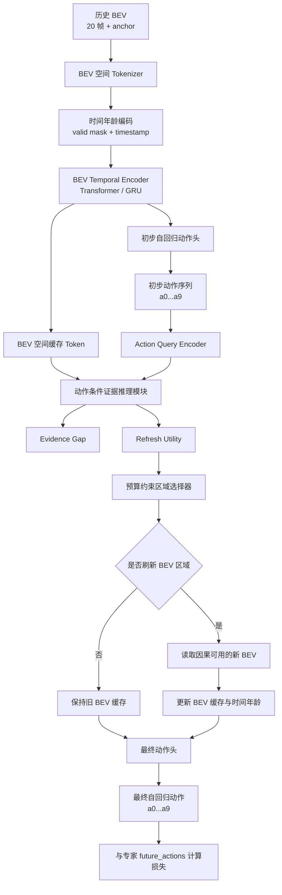

# FRESH-Drive：BEV 时序动作预测与证据刷新统一方案

日期：2026-10-29（Asia/Shanghai）

后续约定：两阶段训练、第一阶段验收与主评测时序见 [两阶段训练与动作预测器有效性验收方案](FRESH-Drive_两阶段训练与动作预测器有效性验收方案_2026-10-31.md)。本文第 4 节逐步扩展观测前缀的规则用于日志回放；锚点一次生成未来 1 秒轨迹时，全程不得读取真实未来 BEV。两种协议分开评价。

本文固定 FRESH-Drive 当前唯一的数据提取、数据加载和模型设计版本。研究输入使用 BEV 特征，不使用车载相机 JPG 作为训练阶段的直接输入。事件发生前的 BEV 用于建立历史上下文和缓存状态；事件发生后的 BEV 按时间因果地作为后续观测或离线刷新收益评估数据；未来专家轨迹只作为动作监督目标。

## 1. 固定数据窗口

事件锚点记为 `t`，采样频率固定为 10 Hz：

```python
FRAME_INTERVAL_US = 100_000   # 100 ms，10 Hz
EVENT_DEDUP_US = 1_000_000     # 同一 DB、同一事件类型的锚点至少相隔 1 s
HISTORY_STEPS = 20             # t 前 2 s
FUTURE_STEPS = 10              # t 后 1 s
WINDOW_SAMPLES = 31             # 20 个历史时刻 + t + 10 个未来时刻
```

事件去密和窗口采样是两个不同概念：`EVENT_DEDUP_US` 只用于避免同一事件类型产生过密锚点；`FRAME_INTERVAL_US` 用于构造轨迹窗口内的 BEV 和自车运动采样。

对每个事件提取：

```text
历史 BEV：t-2.0, t-1.9, ..., t-0.1
锚点 BEV：t
未来 BEV：t+0.1, t+0.2, ..., t+1.0
```

未来动作监督为 10 个相邻时间步：

```text
[t       → t+0.1]
[t+0.1   → t+0.2]
...
[t+0.9   → t+1.0]
```

每一步动作使用自车局部坐标中的连续增量：

```text
[dx, dy, dyaw]
```

`future_trajectory` 保存相对于锚点的累计专家位姿，用于 ADE/FDE 和轨迹可视化；`future_actions` 保存相邻时刻之间的动作增量，用于自回归动作损失。二者不能混用。

历史专家轨迹不作为历史输入。历史 BEV 只提供视觉上下文；历史自车运动状态如果加入模型，应单独保存并明确为输入。未来专家轨迹、未来动作和未来真实 BEV 不得进入第一个动作预测的计算路径。

## 2. 数据文件结构

预处理结果固定存放在：

```text
<root>/nuplan-v1.1/preprocessed_dataset/
├── bev_features/
│   └── <recording>/
│       └── <timestamp>.pt
├── events/
│   └── <recording>/<event_type>/<anchor_timestamp_us>.pt
├── mini-train.pt
└── mini-val.pt
```

`bev_features/<recording>/<timestamp>.pt` 是一个时刻的融合 BEV 缓存，典型字段为：

```python
{
    "bev_features": Tensor[C, H, W],
    "bev_valid_mask": Tensor[H, W],
    "reference_ego_to_global": Tensor[4, 4],
    "image_timestamps_us": Tensor[8],
    "bev_xy": Tensor[H, W, 2],
    "bev_range": Tensor[6],
    "bev_shape": (H, W),
    "ego_state": {...},
    "tracked_objects": {...},
}
```

BEV 的实际 `C、H、W` 以缓存中的张量为准。当前 BEVFormer Tiny 路线预期为 `C=256`、空间大小约为 `50×50`；训练启动前应读取一个缓存文件确认形状。

每个事件文件保存路径引用和监督：

```python
{
    "schema_version": 3,
    "recording": str,
    "event_type": str,
    "anchor_timestamp_us": int,
    "timestamps_us": Tensor[31],
    "relative_time_us": Tensor[31],
    "anchor_index": 20,
    "bev_paths": list[str],
    "bev_valid_mask": Tensor[31, H, W],
    "future_actions": Tensor[10, 3],
    "future_action_mask": Tensor[10],
    "future_trajectory": Tensor[10, 3],
    "causal_context_mask": Tensor[10, 31],
    "future_annotations_are_supervision_only": True,
}
```

`bev_paths` 按时间顺序引用 31 个 BEV 文件。缺失 BEV 或缺失未来运动监督由对应 mask 表示；训练损失只在有效动作步上计算。

当前代码中的 `trajectory["future_expert_trajectory"]` 是锚点坐标系中的累计位姿，不能直接当作相邻动作增量。重新预处理时必须同时生成：

```python
future_trajectory = trajectory["future_expert_trajectory"]
future_actions = frame_to_frame_delta(future_trajectory)
```

转换过程要处理航向角环绕，并保留 `future_action_mask`。

## 3. Lightning 数据加载

训练阶段由 `NuplanDataModule` 加载已经生成的事件和 BEV 缓存：

```text
NuplanDataModule
    ├── setup("fit")
    │   ├── NuplanEventDataset(split="train", preprocess=False)
    │   └── NuplanEventDataset(split="val", preprocess=False)
    ├── train_dataloader()
    └── val_dataloader()
```

`preprocess=False` 表示训练进程只读取 `mini-train.pt`、`mini-val.pt`、事件 `.pt` 和 BEV `.pt`，不扫描 DB、不加载 BEVFormer 编码器，也不重新提取图像特征。预处理和训练使用相同的 `root`：

```yaml
datamodule:
  root: ../datasets/nuplan/nuplan-v1.1
  dir: mini
  train_batch_size: 2
  val_batch_size: 2
  num_workers: 4
  pin_memory: true
  persistent_workers: true
  prefetch_factor: 2
```

`Dataset.get()` 的职责是：

1. 读取一个事件元数据文件。
2. 按 `bev_paths` 顺序读取 31 个共享 BEV 特征。
3. 堆叠为 `bev_features [31, C, H, W]`。
4. 返回未来动作、轨迹、有效掩码、时间戳和因果掩码。

DataLoader 输出的固定张量字段应为：

```python
{
    "bev_features": Tensor[B, 31, C, H, W],
    "bev_valid_mask": Tensor[B, 31, H, W],
    "timestamps_us": Tensor[B, 31],
    "future_actions": Tensor[B, 10, 3],
    "future_action_mask": Tensor[B, 10],
    "future_trajectory": Tensor[B, 10, 3],
    "causal_context_mask": Tensor[B, 10, 31],
    "anchor_timestamp_us": Tensor[B],
}
```

`recording`、`event_type`、`tracked_objects` 和 `route_condition` 等元数据保持为 Python 列表，避免默认 collate 强行堆叠不同结构的对象。

## 4. 因果输入规则

第 `i` 个动作预测只能看到锚点前的历史和已经到达的未来 BEV：

```text
action 0：slots 0..20
action 1：slots 0..21
action 2：slots 0..22
...
action 9：slots 0..29
```

slot 定义为：

```text
0..19：t-2.0..t-0.1
20：t
21..30：t+0.1..t+1.0
```

因此 `causal_context_mask` 的形状为 `[10, 31]`，第 `i` 行允许访问至 `slot=20+i` 的 BEV。未来最后一个观测 `t+1.0` 可以作为日志回放的最后状态，但不应被第 1 至第 10 个动作提前看到。

专家动作目标始终只用于 loss 和离线评估：

```text
预测：a_0, a_1, ..., a_9
目标：a*_0, a*_1, ..., a*_9
```

训练时可对前一步动作使用 teacher forcing；验证和推理时使用模型自己的前一步预测。当前动作目标不能送入刷新前的动作查询。

## 5. 预期模型结构

模型的核心是“BEV 时序编码 → 初步动作 → 动作条件证据推理 → BEV 区域刷新 → 最终动作”。当前缓存是融合 BEV，因此第一版的刷新单位定义为 BEV 空间 token 或局部 BEV 区域。模型不会声称可以直接选择某一路相机，除非后续缓存增加逐相机 BEV 贡献。



### 5.1 BEV 空间 Tokenizer

输入：

```text
bev_features [B, T, C, H, W]
```

通过线性投影或 `1×1 Conv` 投影到隐藏维度 `D`，再用固定网格池化得到 `P` 个空间 token：

```text
[B, T, C, H, W] → [B, T, P, D]
```

每个 token 加入空间位置编码、BEV 时间年龄编码和有效区域 mask。BEV 融合后的表示已经不保留相机身份，因此不能把这些 token解释为八路相机 token。

### 5.2 BEV Temporal Encoder

Temporal Encoder 读取历史 20 帧和锚点 BEV，维护当前决策状态：

```text
历史 BEV token + age + valid mask
        ↓
空间注意力 / 时间 Transformer
        ↓
hidden state h_t
```

第一版可使用轻量 Transformer 加 GRU，或只使用 GRU 作为对照。时间编码器不读取未来专家动作，也不读取完整未来 BEV。

### 5.3 自回归动作头

动作解码器每一步输出一个连续动作：

```python
a_i = [dx_i, dy_i, dyaw_i]
```

第 `i+1` 步使用前一步的动作 embedding 或 teacher-forcing 动作 embedding，并结合当前隐藏状态。所有 10 步共享动作头参数，避免把未来步数当成独立分类标签。

建议第一阶段损失：

```text
L_action = SmoothL1(dx, dy)
          + yaw_weight × SmoothL1(wrapped_dyaw)
          + λ_traj × trajectory_loss
```

`trajectory_loss` 在累计动作得到的锚点坐标系轨迹上计算；逐步动作误差和累计轨迹 ADE/FDE 分开记录。

### 5.4 动作条件证据推理与刷新

初步动作经过 MLP 得到 `action_query`，与当前 BEV 空间缓存交叉注意力：

```text
BEV cache tokens + action query + age + budget
                ↓
         evidence gap
                ↓
         refresh utility
                ↓
     预算约束 BEV 区域选择
```

刷新选择允许空集合，回答“当前是否需要刷新”。成本、预算和调度开销需要计入比较。选择后的新 BEV 只能来自当前因果可用的未来观测，更新缓存后再运行最终动作头。

刷新收益监督固定为动作误差改善：

```text
U(S) = D(action_from_old_cache) - D(action_from_updated_cache)
```

第一版冻结动作预测器，训练刷新收益头；后续再研究刷新器与动作头的联合微调。证据缺口必须实际进入收益预测，不能只作为旁路解释输出。

## 6. 训练阶段

### 阶段一：BEV 动作预测基线

输入历史 20 帧和锚点 BEV，使用真实未来动作作为监督，未来 BEV 只按因果规则用于日志回放。训练目标是验证 BEV 特征是否能支持短期自回归专家轨迹预测。

### 阶段二：动作条件 BEV 刷新

冻结阶段一的动作预测器。在同一缓存状态下，用真实日志中可用的新 BEV 替换候选区域，计算动作误差改善作为 `refresh_utility` 目标，训练证据推理和预算选择模块。

### 阶段三：联合微调与闭环

只有阶段一和阶段二稳定后，才联合微调动作预测器和刷新器，并在 CARLA 连续回放中维护真实 BEV 缓存。离线事件窗口不能直接代表闭环控制结果。

## 7. 现有缓存与本方案的关系

当前代码仍使用 `EVENT_INTERVAL_US=1_000_000` 作为 BEV 和轨迹采样间隔，默认 `history_features=8`、`future_action=8`，生成的是约 1 Hz、事件前后各 8 秒的缓存。因此当前缓存**不能直接作为本方案的 10 Hz、2 秒历史和 1 秒未来训练数据**。

切换本方案后，需要重新生成事件和 BEV 缓存，并同步更新：

1. `datasets/dataset_utils.py` 的采样间隔常量和轨迹窗口构造。
2. `preprocess_dataset.py` 与 `datasets/nuplanevent_dataset.py` 的默认窗口参数和事件字段。
3. `NuplanEventDataset.get()` 的堆叠形状与未来动作字段。
4. `NuplanDataModule` 的批处理字段。
5. 模型的时间步检查、因果 mask 和损失接口。
6. `config/train/action.yaml` 与 `config/train/refresh.yaml` 的窗口参数。

旧缓存仍可作为实验归档，但不应与新缓存混合在同一个训练清单中。缓存版本、采样间隔和窗口长度需要写入事件文件，避免加载时误用。

## 8. 复现实验记录

每次运行应记录：

- `FRAME_INTERVAL_US=100000`；
- `EVENT_DEDUP_US=1000000`；
- `HISTORY_STEPS=20`、`FUTURE_STEPS=10`、`WINDOW_SAMPLES=31`；
- BEV 张量实际形状和数据类型；
- 有效历史 BEV 数、未来动作 mask 和缺失 BEV 数；
- train/val 的 recording 列表及交集；
- 模型使用的因果 mask；
- 动作损失、轨迹 ADE/FDE、刷新次数、刷新成本和预算；
- 旧缓存与新缓存是否混用。

## 9. 相关文件

- [预处理 Dataset](../../preprocess_dataset.py)
- [Dataset 实现](../../datasets/nuplanevent_dataset.py)
- [Lightning DataModule](../../datamodules/nuplan_datamodule.py)
- [BEV 与轨迹工具](../../datasets/dataset_utils.py)
- [三类 Token 与动作条件刷新设计](FRESH-Drive_三类Token与动作条件刷新模块设计_2026-10-25.md)
- [动作条件证据推理验证方案](FRESH-Drive_动作条件证据推理与验证方案_2026-10-23.md)
- [动作条件 BEV 世界模型与证据刷新扩展方案](FRESH-Drive_动作条件BEV世界模型与证据刷新方案_2026-10-30.md)
